<div align="center">

# ARGO-Q4 · Robotics Showcase

**A hydraulic quadruped field robot with a 5-DOF manipulator — designed, modelled and animated entirely in code, then shipped as an interactive website and an offline Android app.**

[](https://github.com/jaineil32624/robotics-showcase/actions/workflows/ci.yml)


[**Live 3D demo**](https://jaineil32624.github.io/robotics-showcase/) · [**Download the APK**](https://github.com/jaineil32624/robotics-showcase/releases/latest) · [Documentation](documentation/) · [Renders](renders/)

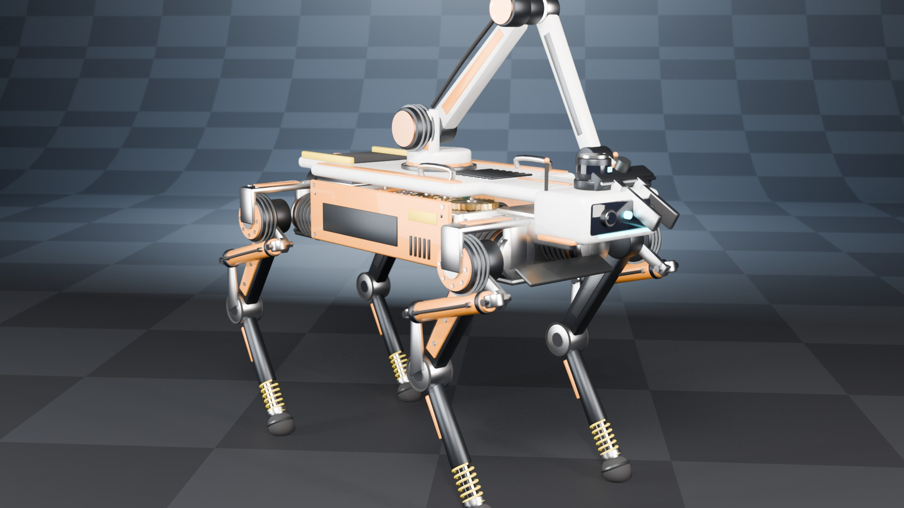

</div>

---

## Project overview

ARGO-Q4 is a concept for a field robot that can walk over rough ground and handle samples with its own arm. It was engineered the way real robots are: **kinematics first, actuators sized from the motion they must produce, and every moving part doing a job.**

Nothing in the model is hand-placed. A pure-Python kinematics module defines the geometry and every pose; a Blender script builds **69 mechanical components** (motors, pistons, gears, bearings, hoses, springs, electronics), bakes **10 animation sequences / 2 490 frames**, and exports one asset that powers both the website and the Android app.

| | |
|---|---|
| **Actuated joints** | 18 DOF (4 × 3-DOF legs, 5-DOF arm, parallel gripper) |
| **Knee drive** | Double-acting hydraulic cylinders via a heel lever, 207 mm stroke |
| **Gait** | Diagonal trot, Raibert foothold placement, 0.5 m/s |
| **Arm** | 0.93 m reach, 5 kg payload, continuous wrist roll |
| **Power** | 48 V · 24 Ah · 1.15 kWh Li-NMC, 21 MPa hydraulic power unit |
| **Mass (sum of parts)** | 54.5 kg |

> ARGO-Q4 is a digital prototype: geometry and motion are computed and verified in code; torque, runtime and pressure figures are design targets.

## Features

**Blender model & animation**
- 69 named, metadata-tagged components built procedurally with `bmesh` — bevelled housings, cooling fins, bolt circles, spur gears, tori, swept hoses, helical springs
- Analytic leg IK (abduction plane + two-link) and 5-DOF arm IK with approach angle
- Feet stay planted to < 0.5 mm/frame while the body accelerates (unit-tested)
- Knee hydraulics aimed every frame; cylinder & rod lengths **sized automatically** from the baked stroke
- Gear speeds coupled by tooth count, payload spring-damper sag, crate drop with gravity & restitution
- Exploded view with per-part assembly vectors, 7 cinematic cameras bound to timeline markers

**Animation sequences** — Power-on · Mechanical startup · Idle (seamless loop) · Joint demonstration · Walking cycle · Arm manipulation · Object interaction · Full operating mode · Shutdown · Exploded view

**Website** (Next.js · React Three Fiber · Tailwind)
- Interactive viewer: orbit / zoom / pan, camera presets, follow-cam
- Click any component → info card with description, specs, mass; isolate & focus
- Clip selector, scrubber, speed, loop, in-place walking, X-ray (hide shell), wireframe, explode slider
- Engineering specs page with joint table, kinematic diagram, mass budget, actuator register
- Animation showcase, build-process page, responsive from 360 px to 4K, adaptive DPR & performance monitor

**Android app** (React Native / Expo)
- Native menus, bottom-sheet panels, settings persisted on device, Android back-button handling
- Touch orbit / pinch / pan, tap-to-inspect parts, animation playback with touch scrubber
- Quality presets (pixel ratio + shadows), FPS overlay, fully **offline** — model & renderer are inside the APK

## Demonstrations

| Walking cycle | Pick & stow | Exploded view |
|---|---|---|
| 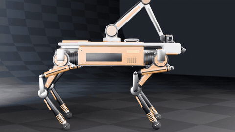 | 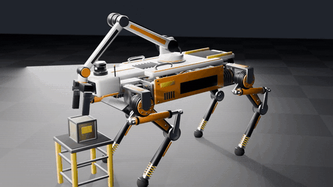 | 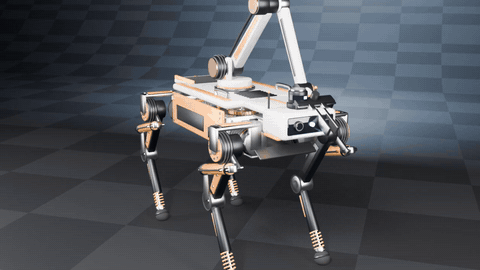 |

| Power-on | Joint demo | Shell hidden (X-ray) |
|---|---|---|
| 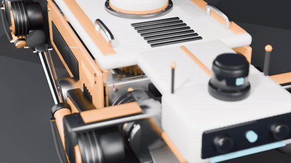 | 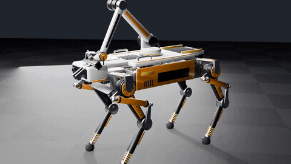 | 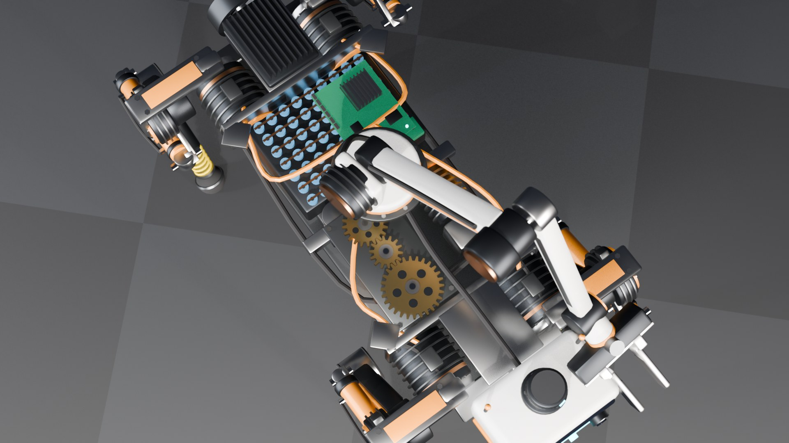 |

Full-length 720p renders of every sequence are in [`videos/`](videos/) (`ARGO-Q4_full_showcase.mp4` plus one MP4 per clip).

## Screenshots

| Website — 3D viewer | Website — specs | Mobile layout |
|---|---|---|
| 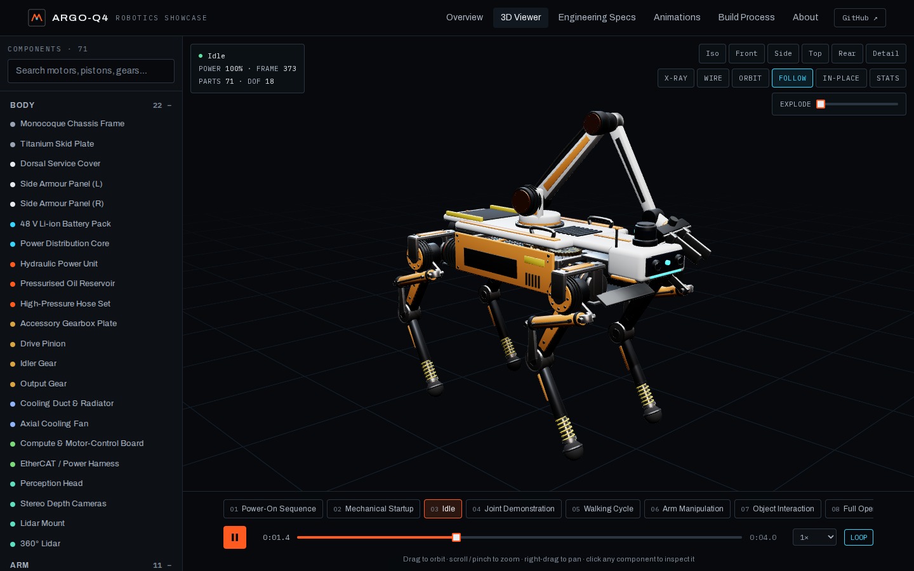 | 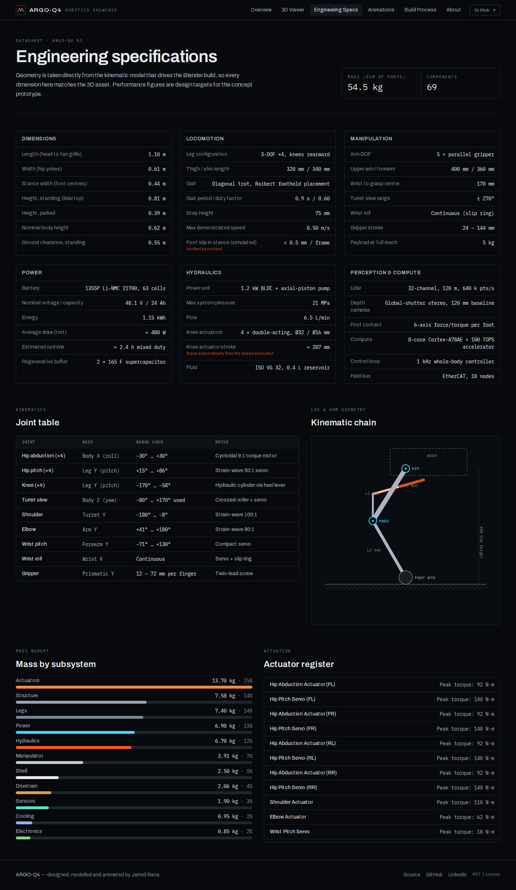 | 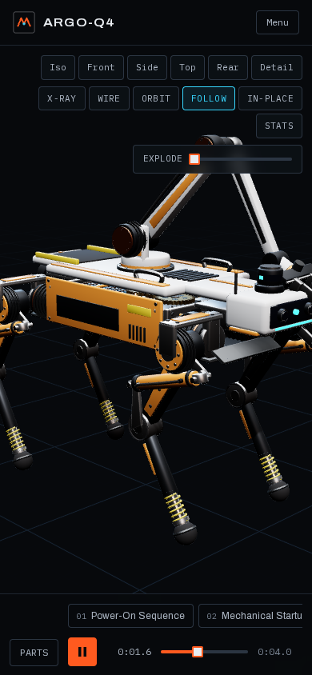 |

## Technology stack

| Layer | Tools |
|---|---|
| Kinematics & choreography | Python 3 (no dependencies), unit tests |
| Modelling, baking, rendering | Blender 5.2 · `bpy` · `bmesh` · EEVEE · glTF 2.0 exporter |
| Web | Next.js 15 (static export) · React 19 · Three.js · React Three Fiber · drei · Tailwind CSS 4 |
| Mobile | React Native 0.79 · Expo SDK 53 · react-native-webview · AsyncStorage · esbuild |
| CI/CD | GitHub Actions → GitHub Pages + signed-debug release APK |

## Architecture

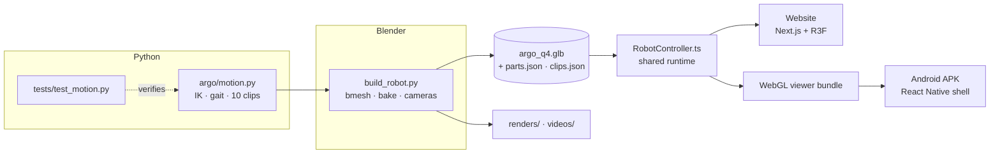

## Repository structure

```
robotics-showcase/
├── blender/            build_robot.py, argo/motion.py, tests/, argo_q4.blend
├── assets/model/       argo_q4.glb, parts.json, clips.json (exported)
├── website/            Next.js app (src/lib/core = shared RobotController)
├── mobile-app/         Expo / React Native app + offline WebGL viewer
├── engineering/        actuator sizing study, bill of materials
├── documentation/      design notes, pipelines, deployment, APK build
├── renders/            EEVEE stills
├── videos/             per-clip MP4s, full showcase film, GIFs
├── screenshots/        website captures from CI
└── .github/workflows/  CI: tests → website → Pages, Android APK
```

## Installation

```bash
git clone https://github.com/jaineil32624/robotics-showcase.git
cd robotics-showcase
python blender/tests/test_motion.py        # kinematics self-test (no deps)
```

### Website setup

```bash
cd website
npm install
npm run dev            # http://localhost:3000  (copies the GLB + renders into public/)
npm run build          # static export in website/out
```

Deploy `website/out` to any static host. CI publishes it to GitHub Pages with `NEXT_PUBLIC_BASE_PATH=/robotics-showcase`. See [deployment](documentation/deployment.md).

### Mobile build

```bash
cd mobile-app
npm install
npm run build:viewer                 # bundles three.js viewer + embeds the GLB
npx expo prebuild --platform android
cd android && ./gradlew assembleRelease
# → android/app/build/outputs/apk/release/app-release.apk
```

Every push to `main` builds the APK in GitHub Actions (artifact **ARGO-Q4-apk**); tags `v*` attach it to a Release. Details: [APK build process](documentation/apk-build.md).

### Blender workflow

```bash
# headless rebuild of the model, animation and exports
blender --background --python blender/build_robot.py -- --out assets/model
```

Or open Blender → *Scripting* → open `blender/build_robot.py` → *Run Script*. `render_stills()` and `render_videos()` regenerate `renders/` and `videos/`. See [Blender workflow](documentation/blender-workflow.md).

## Engineering notes

- **Leg IK** — abduction solves the lateral offset analytically (`α = atan2(z, y) + acos(w/d)`), then a two-link planar solution with the knee-rearward branch. FK round-trip error < 1 µm.
- **Gait** — trot, period 0.9 s, duty 0.6. Footholds are placed under the hip at mid-stance of the *next* stance phase using the integrated body trajectory, so feet never slide during acceleration or braking.
- **Hydraulics** — a grid search ([`engineering/knee_actuator_sizing.py`](engineering/knee_actuator_sizing.py)) placed the clevises so one cylinder covers the 112° knee range (`d_max ≤ 2·d_min − clearance`). Measured pin length 264 → 471 mm.
- **Trajectories** — every point-to-point move uses a minimum-jerk quintic, the profile used by industrial servo controllers.
- **Runtime** — the GLB holds one 83 s baked timeline; clips are played by driving `action.time` inside each clip's frame window, which stays correct even where the exporter removed duplicate keys.

More in [mechanical design](documentation/mechanical-design.md), [animation pipeline](documentation/animation-pipeline.md), [asset pipeline](documentation/asset-pipeline.md) and [Three.js integration](documentation/threejs-integration.md).

## Future improvements

- Physics-validated gait in MuJoCo / Isaac Sim using the same kinematic parameters
- ROS 2 URDF export from the part catalogue
- Terrain-adaptive stepping and turning gaits
- Draco / Meshopt compression and KTX2 for a smaller asset
- iOS build and AR placement (WebXR / ARCore)

## License

[MIT](LICENSE) © 2026 Jaineil Rana
